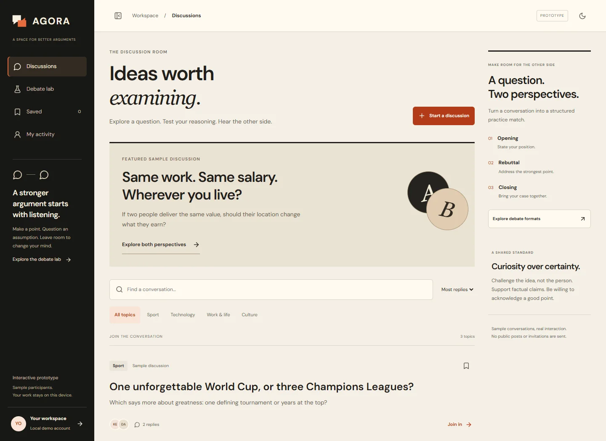

# Agora — a space for better arguments

A React and TypeScript discussion workspace with structured practice and a separate local AI debate lab. The redesigned interface uses self-hosted DM Sans, cream and ink surfaces, restrained burnt-orange actions, editorial headlines and neutral perspective markers, light and dark themes, a compact desktop sidebar and mobile navigation.

[Try the browser demo](https://olatomii-agora.pages.dev/) · [Portfolio case study](https://olatomii-portfolio.pages.dev/projects/agora)



## Run locally

Use Node.js 20.19+ or a supported current LTS release.

```sh
npm ci
npm run dev
```

For optional AI debates, copy `.env.example` to `.env.local` and configure your own provider key. Keep it server-side; never prefix secrets with `VITE_`. Provider requests can incur charges. The development middleware is intended for local use, not a public multi-user deployment.

## Explore

Start with Discussions. Search or filter sample topics, save one, create a discussion or reply. Challenge a sample participant, preview acceptance, then complete opening, rebuttal and closing statements. Practice responses are explicitly scripted and no real verdict is invented. Debate lab separates the AI setup from the sample debate archive. Opening a sample replay locks predictions.

The local AI engine coordinates two agents over three rounds and a separate judge, with input validation, cancellation, evidence checks and failure states. Tests use mocked responses; verification does not spend provider credits.

## Build and test

```sh
npm test
npm run build
node export-preview.mjs
```

The export writes `../agora-preview.html` with embedded fonts and scripts. The public portfolio hosts this standalone preview: it uses local browser storage, has no sign-in or remote persistence, and disables live AI connections. AI setup remains visible as a clearly labelled preview.

## Architecture

- `src/App.tsx`: navigation, theme and local persistence.
- `src/Forum.tsx`: discussions, replies and challenge invitation.
- `src/MatchViews.tsx`: practice rounds, replay and predictions.
- `src/AiLab.tsx`: setup, run status, transcripts and judge presentation.
- `src/model.ts`: typed state transitions, validation and sample data.
- `src/labTypes.ts` and `server/lab.ts`: AI run types and server orchestration.
- `src/studio.css`: unified responsive design system and reduced-motion support.
- `src/ui.tsx`: shared UI and native dialog behaviour.

Production would require authenticated identity, durable authoritative state, permissions, rate limits, cost controls and independent evaluation of judging quality. This prototype does not implement multiplayer or payments.

## Continuous integration

GitHub Actions runs the tests and production build on pushes and pull requests, then saves the self-contained browser preview as a downloadable artifact. Tests mock the AI provider and require no API key.

## Cloudflare Pages preview

The public demo is hosted at https://olatomii-agora.pages.dev/ as static files, with no sleeping application server. Build with `npm run build`, then `node export-preview.mjs dist/index.html`, and deploy from this repository using `npx wrangler pages deploy dist --project-name olatomii-agora --branch main`. The export explicitly disables live AI/provider requests. No secrets are included in this deployment. Browser-local data is specific to this new origin; previous demo data stays in the old browser origin.

This is a direct-upload Pages project; a GitHub push does not automatically deploy it. Run the commands above after tests pass.
